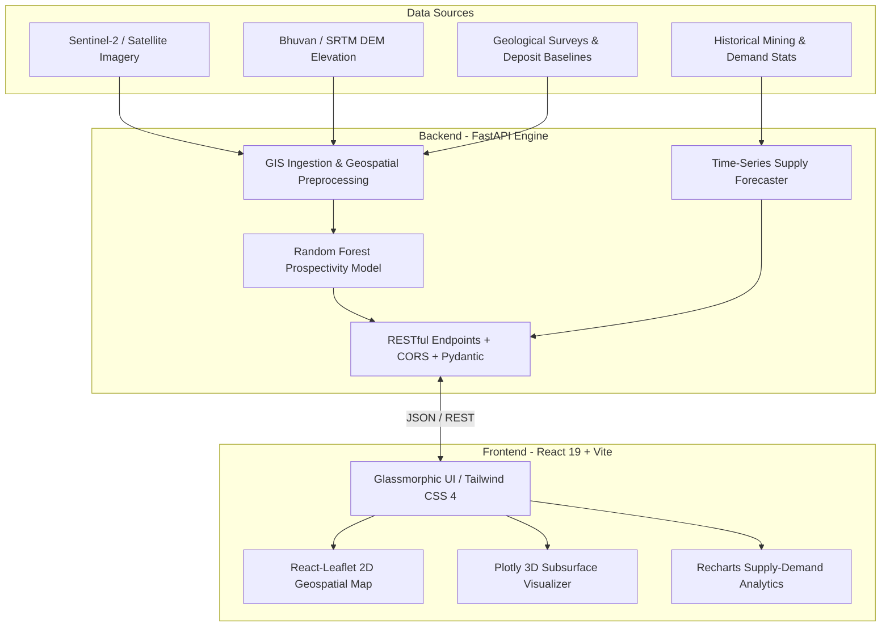

# ⚡ ManganEX – AI-Powered Manganese Mineral Exploration & Supply Intelligence

[](#)
[](#)
[](#)
[](#)
[](#)
[](#)
[](#)
[](#)

---

## 📌 Executive Summary

Manganese is a critical strategic mineral indispensable for high-strength steel manufacturing, next-generation electric vehicle (EV) battery chemistries (e.g., NMC cathodes), and renewable energy infrastructure. 

Traditional mineral exploration is arduous, environmentally invasive, capital-intensive, and reliant on manual geological field surveying. **ManganEX** modernizes this paradigm by uniting **Geographic Information Systems (GIS)**, **Multispectral Satellite Remote Sensing (Sentinel-2 / Landsat)**, and **Machine Learning** into an end-to-end intelligence platform:
1. **Identifies and ranks prospective exploration zones** across major Indian manganese belts with high spatial accuracy.
2. **Visualizes subsurface topologies in 3D** to guide precision core drill planning.
3. **Forecasts national production-consumption deficits** up to 20 years into the future to inform raw material supply-chain resilience.

---

## 🌟 Key Features

### 1. 🗺️ Interactive Geospatial Dashboard
- Built with **React-Leaflet** and tailored dark-mode GIS cartography.
- **Multi-point coordinate picking**: Click multiple targets across the map or enter coordinates directly to inspect prospectivity concurrently.
- **Layer Switching**: Toggle between satellite views (Esri World Imagery), structural geological boundaries, known deposit clusters, and magnetic anomalies.
- Automatic boundary clipping and bounding-box geometry validation for India's primary metallogenic provinces.

### 2. 🧠 AI Prospectivity Engine (Multi-Region Random Forest)
- Machine learning models trained on structural features, terrain metrics (elevation, slope gradient), and spectral vegetation/iron-oxide indices.
- Outputs classified exploration priorities (**High**, **Moderate**, **Low**) with calibrated probability confidence distributions.
- **Spatial Decay & Proximity Fallbacks**: Resilient multi-tier prediction system ensuring reliable inferences even in areas with sparse raster coverage.

### 3. 🧊 Interactive 3D Subsurface Visualization
- Powered by **Plotly.js** with full 360° pan/tilt/zoom orbital control.
- Renders high-resolution synthetic/interpolated terrain elevation surfaces.
- Models subsurface drill targets along depth profiles (0m to -300m) with deterministic seed reproduction to evaluate vertical ore continuity.

### 4. 🔍 Model Explainability & Transparency (XAI)
- Dynamically extracts Random Forest `feature_importances_` for every inference.
- Displays top driving features (e.g., iron-oxide absorption, proximity to fault structures, slope angle).
- *Strict scientific integrity*: Explicit notices differentiate mathematical feature correlations from proven geological causation.

### 5. 📈 Macroeconomic Supply & Demand Forecasting
- Analyzes historical domestic production, consumption, export quotas, and import dependency.
- Uses time-series linear trend regression to project future mineral supply deficits and surplus scenarios up to 20 years ahead.

### 6. 🇮🇳 Pre-Configured Indian Metallogenic Belts
ManganEX includes pre-mapped coordinate extents and deposit baselines for India's 6 largest manganese belts:
- **Sandur-Ballari (Bellary) Belt**, Karnataka *(Primary Pilot Zone)*
- **Nagpur-Bhandara Belt**, Maharashtra
- **Balaghat Belt**, Madhya Pradesh
- **Keonjhar-Sundargarh Belt**, Odisha
- **Shimoga-North Kanara Belt**, Karnataka
- **Srikakulam-Visakhapatnam Belt**, Andhra Pradesh

---

## 🏗️ System Architecture



---

## 📂 Project Structure

```
SIH-manganese-exploration-ai/
│
├── backend/                        # FastAPI REST API & Machine Learning engine
│   ├── app/
│   │   ├── data_pipeline/          # Geospatial ingestion, raster & vector validation
│   │   ├── forecasting/            # Supply/demand linear time-series modeling
│   │   ├── ml/                     # Random Forest predictors, multi-region pipelines
│   │   └── main.py                 # Core FastAPI router & application entrypoint
│   ├── data/                       # Raw, sample, and processed mineral datasets
│   ├── models/                     # Saved Scikit-Learn model artifacts & weights
│   ├── Dockerfile                  # Production container definition (with GDAL/PROJ)
│   ├── requirements.txt            # Python dependencies
│   └── .env.example                # Template for environment configuration
│
├── frontend/                       # Modern React 19 Single Page Application
│   ├── src/
│   │   ├── components/             # Reusable UI components (Map, 3D, Forecast, Navbar)
│   │   │   ├── MapComponent.jsx    # React-Leaflet GIS visualization
│   │   │   ├── Visualization3D.jsx # 3D orbital subsurface terrain model
│   │   │   └── ForecastDashboard.jsx # Recharts supply/demand charts
│   │   ├── App.jsx                 # Core state orchestration & dashboard layout
│   │   └── index.css               # Design system & dark theme tokens
│   ├── Dockerfile                  # Multi-stage production Nginx container
│   ├── package.json                # Frontend dependencies & scripts
│   └── vite.config.js              # Vite bundling configuration
│
├── docker-compose.yml              # Multi-container orchestration (Backend + Frontend)
├── run_manganex.bat                # Windows one-click local launcher
├── ManganEX_Final_Prospectivity_Map.html # Standalone offline GIS map
└── README.md                       # Comprehensive project documentation
```

---

## ⚡ Quick Start & Installation

### Prerequisites
- **Node.js** (v18 or higher)
- **Python** (v3.9 or higher)
- **Git**

---

### Option A: One-Click Launch (Windows)
Simply double-click [`run_manganex.bat`](file:///e:/study/SIH/SIH-manganese-exploration-ai/run_manganex.bat) or run from your terminal:
```bat
.\run_manganex.bat
```
*This automatically boots the FastAPI backend (port 8000), starts the Vite development server (port 5173), and opens the dashboard in your default browser.*

---

### Option B: Manual Setup

#### 1. Start the Backend
```bash
cd backend

# Create & activate a virtual environment
python -m venv venv
# On Windows:
.\venv\Scripts\activate
# On Linux/macOS:
source venv/bin/activate

# Install dependencies
pip install -r requirements.txt

# Start the server
python -m uvicorn app.main:app --host 0.0.0.0 --port 8000 --reload
```
*API will be live at `http://localhost:8000` (Swagger docs at `http://localhost:8000/docs`).*

#### 2. Start the Frontend
```bash
cd frontend

# Install Node dependencies
npm install

# Start Vite dev server
npm run dev
```
*Frontend will be live at `http://localhost:5173`.*

---

### Option C: Production Docker Launch
Run both services in containerized isolation:
```bash
docker-compose up -d --build
```
- **Web App**: `http://localhost:80`
- **API**: `http://localhost:8000`

---

## 🔌 API Reference

| Method | Endpoint | Description |
| :--- | :--- | :--- |
| `GET` | `/api/health` | Uptime health status verification |
| `GET` | `/api/model/status` | Current ML model operational status and metadata |
| `POST` | `/api/predict` | Single-point AI prospectivity prediction based on coordinates |
| `POST` | `/api/predict/multiregion` | Multi-region prospectivity analysis across Indian belts |
| `GET` | `/api/geospatial/pilot-region` | Bounding box & CRS definitions for Sandur-Ballari pilot zone |
| `GET` | `/api/geospatial/state-deposits` | Known deposits filtered by state with centroid priority scores |
| `POST` | `/api/geospatial/validate` | Validates uploaded Shapefiles (`.shp`), GeoJSON, or GeoTIFFs |
| `GET` | `/api/forecast/status` | Health & sample count of the macroeconomic supply forecaster |
| `POST` | `/api/forecast` | Generates historical and future supply/demand timelines |
| `GET` | `/api/multiregion/status` | List of supported manganese belts and model statuses |

---

## 🌐 24/7 Public Cloud Deployment

For permanent public access:
1. **Frontend**: Deploy `frontend/` on [**Vercel**](https://vercel.com) (Vite preset, set `VITE_API_URL` to your backend URL).
2. **Backend**: Deploy `backend/` on [**Render**](https://render.com) using the provided [`backend/Dockerfile`](file:///e:/study/SIH/SIH-manganese-exploration-ai/backend/Dockerfile).
3. **24/7 Keep-Alive**: Add a free HTTP monitor at [**UptimeRobot**](https://uptimerobot.com) pinging `/api/health` every 5 minutes to prevent cold starts.

---

## ⚠️ Scientific & Demonstration Notice

> **Disclaimer**: ManganEX incorporates authentic geological boundaries, known deposit inventories, and baseline spectral modeling principles. However, synthetic parameters and demonstration proxies are utilized for regions where high-resolution field drill logs or classified satellite datasets are legally restricted or proprietary. Predictions represent computational prospectivity indicators and should be validated through professional ground-truthing and geochemical assays before commercial mining investment.

---

## 👥 Authors & Acknowledgments

- **Developed for:** Smart India Hackathon (SIH) – Problem Statement: AI/ML Powered Mineral Prospectivity & Supply Intelligence.
- **Geological Reference Data:** Geological Survey of India (GSI) public inventories, Indian Bureau of Mines (IBM), and ISRO Bhuvan open data services.
